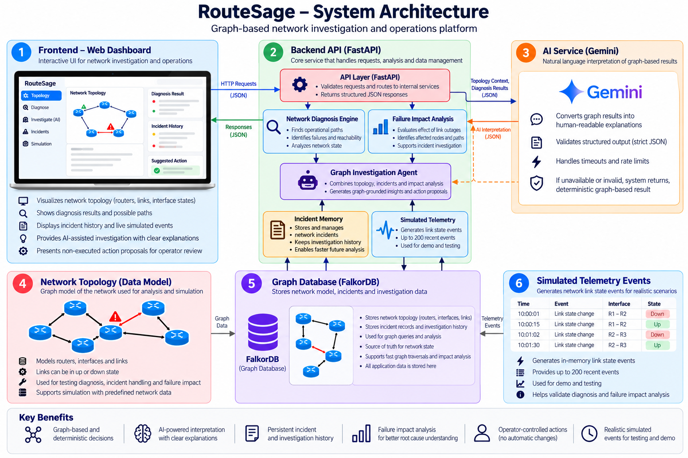

# RouteSage — Graph-Grounded Network Reliability Intelligence

RouteSage is a network troubleshooting prototype that models routers, interfaces, and links in FalkorDB, evaluates source-to-destination reachability, exposes path and failure evidence, and stores incident history. An optional Gemini integration explains the graph-verified diagnosis and suggests investigation steps.

## How RouteSage works

RouteSage is a graph-grounded network operations agent for the question:
**“What breaks if this link fails, what still works, and what should an
operator do next?”** It follows multi-hop relationships in FalkorDB instead of
guessing from isolated records, compares physical-link failure with
end-to-end reachability, remembers investigations across sessions, and shows
the evidence path behind each recommendation. The agent can recommend a
specific safe graph action, while topology changes and incident resolution
remain under explicit human control.

## What it does

- Represents routers, interfaces, and connections as graph entities and relationships in FalkorDB.
- Evaluates operational paths using link and interface state, and reports alternate paths that are operational or affected by failures.
- Provides read-only failure-impact analysis for a selected link by comparing the current graph with a hypothetical outage. It reports affected router pairs, surviving paths, newly unreachable pairs, and maximum link-disjoint operational paths as the redundancy metric.
- Provides a FastAPI backend and a browser dashboard with Overview, Topology Explorer, AI Investigation, Incident Center, and Reliability Analytics views.
- Computes live topology analytics from the graph snapshot, including operational/failed link counts, average operational degree, and routers with limited operational neighbors.
- Filters incident history locally by route, cause, symptom, remediation, or incident identifier, with open/resolved status filters.
- Stores incident records and retrieves matching cases by endpoints and symptom.
- Uses stable, unordered interface-pair identifiers for link-associated incident deduplication. Restoring a link resolves only incidents tied to that exact link, and only when end-to-end reachability is subsequently verified.
- Offers an opt-in, bounded simulated telemetry event stream for local demonstrations; it is never live device telemetry.
- Optionally calls Gemini to summarize the verified diagnosis, interpret evidence, and suggest safe investigation steps.
- Provides a graph investigation agent that combines topology diagnosis,
  failure impact, and incident memory into one explainable decision. Each
  remembered investigation is stored in FalkorDB and linked to the analyzed
  router pair.

## Architecture

The following diagram illustrates RouteSage's architecture, including the dashboard, API services, FalkorDB graph, optional Gemini explanations, incident memory, and simulated telemetry.


## Quick start (Windows PowerShell)

1. Start Docker Desktop. If the demo container does not exist, run:

   ```powershell
   docker run -d --name routesage-falkordb -p 6379:6379 -p 3000:3000 falkordb/falkordb:latest
   ```

   If the container already exists but is stopped, use `docker start routesage-falkordb` instead.

2. From the repository root, create and activate a virtual environment, then install dependencies:

   ```powershell
   python -m venv .venv
   .\.venv\Scripts\Activate.ps1
   python -m pip install -r requirements.txt
   ```

3. Configure optional Gemini explanations by creating a local `.env` file (do not commit it):

   ```dotenv
   GEMINI_API_KEY=your_api_key
   GEMINI_MODEL=gemini-3-flash-preview
   ROUTESAGE_AI_RATE_LIMIT=20
   ```

   Without `GEMINI_API_KEY`, graph diagnosis remains available through `POST /api/diagnose`. `POST /api/ai/diagnose` returns a clearly labeled deterministic fallback when Gemini is unconfigured, times out, is rate-limited, unavailable, or returns malformed JSON; that fallback contains only supplied graph-diagnosis facts. FalkorDB defaults to `localhost:6379`; `FALKORDB_HOST`, `FALKORDB_PORT`, and `FALKORDB_GRAPH` can override the defaults.

   `ROUTESAGE_AI_RATE_LIMIT` defaults to 20 AI requests per client IP per 60 seconds in the local process. It is a local safeguard, not a distributed production rate limiter.

4. Start the API and dashboard:

   ```powershell
   python -m uvicorn backend.api:app --reload --port 8001
   ```

   Open http://127.0.0.1:8001. Interactive API documentation is available at http://127.0.0.1:8001/docs.

## Demo flow

1. Verify the database connection status.
2. If the graph is empty, use `POST /api/demo/seed` in `/docs` to load the demonstration topology.
3. In **Topology Explorer**, inspect routers and links; select a connection to simulate a failure.
4. In **AI Investigation**, choose `EDGE-01` to `DB-01` and select
   **Ask graph agent**. Show its decision, failed-interface evidence,
   operational route, impact comparison, and evidence trace. Explain that the
   investigation is remembered in FalkorDB.
5. Use **Diagnose connectivity** for the optional Gemini explanation. Gemini
   interprets graph facts but cannot change the network.
6. In **Incident Center**, search incident records and filter by open/resolved status.
7. In **Reliability Analytics**, inspect metrics calculated from the current graph snapshot; inject/restore a link and refresh to see the figures change.
8. Restore the link and confirm connectivity/redundancy changes.


## Tests

With FalkorDB running, execute:

```powershell
python -m pytest backend/tests -v
```

The tests use isolated graph names. They require a reachable FalkorDB instance.

## Simulated telemetry

`POST /api/simulation/start` enables recording of simulated link-state events caused by the demo controls. Inspect the bounded local stream with `GET /api/simulation/events`, then call `POST /api/simulation/stop`. Every event is labeled `source: simulated`; RouteSage does not ingest telemetry from real network devices.

## Graph agent contract

`POST /api/agent/investigate` runs a bounded investigation over the current
FalkorDB state. It calls deterministic diagnosis, identifies failed interface
evidence, compares a selected or graph-identified link outage, and reads
matching incident context. With `remember: true` (the dashboard default), it
persists an `Investigation` node connected to the analyzed `Router` nodes.
The endpoint never changes link state, creates incidents, or resolves incidents.
Its `proposed_action` is an explicit, non-executed request shape for an operator
to review and execute; `executed` is always `false` in this endpoint.

## Scope and limitations

- The bundled topology is demonstration data, not live device telemetry.
- There is no SNMP, streaming telemetry, packet-capture ingestion, or autonomous remediation.
- Failure-impact analysis is bounded to at most 100 router pairs and 100 paths per pair; it is a hypothetical comparison, not a predictive network simulator.
- Link-associated incident deduplication uses source, destination, and a stable unordered pair of interface IDs. Legacy incidents without a link reference are preserved as independent records rather than deduplicated from free text.
- Gemini output is generated from supplied graph context but is not a formal proof. Treat cause statements as hypotheses and recommendations as suggestions for human review.
- Investigation memory is local to the configured FalkorDB graph; it is not
  tenant-isolated and has no retention policy in this prototype.
- This is a prototype, not a production network-management system; authentication, authorization, deployment hardening, and operational observability would be needed before production use.

RouteSage combines graph-verified diagnosis, traceable evidence, and persistent incident memory to support network troubleshooting.
