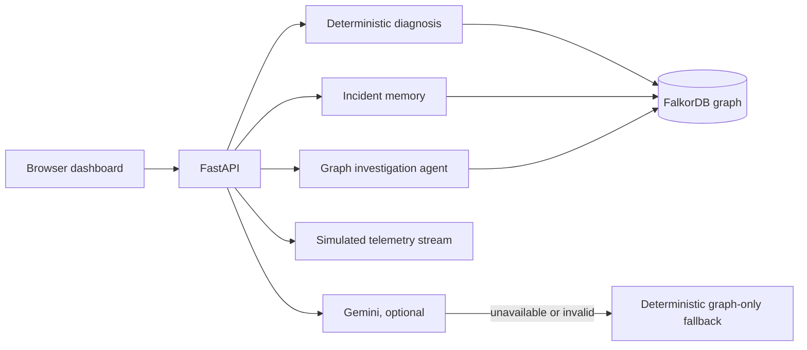
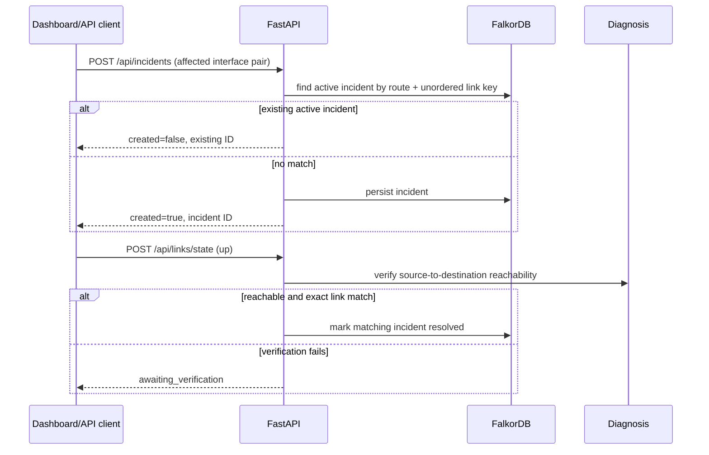

# RouteSage architecture

RouteSage is a local, graph-backed investigation prototype. FalkorDB topology
analysis is authoritative for reachability; Gemini is optional interpretation.

## Responsibilities

- **Frontend:** renders topology, evidence, incident history, and clearly marks
  a deterministic fallback when AI interpretation is unavailable.
- **API:** validates requests, controls the local demo topology, and returns
  safe public errors rather than database exception text.
- **Diagnosis:** enumerates bounded simple paths and only marks paths usable
  when the link and both participating interfaces are `up`.
- **Failure impact:** reads the current graph snapshot, compares each bounded
  router pair with a hypothetical selected-link outage, and reports reachability
  and maximum link-disjoint operational paths. FalkorDB supplies the graph
  facts; these bounded calculations run in Python and are read-only.
- **Graph investigation agent:** combines diagnosis, failure impact, and
  incident context into a bounded decision. It persists an `Investigation`
  node linked to the analyzed source and destination routers, so a later
  investigation can retrieve prior decisions from FalkorDB. It recommends
  actions but does not mutate links or incidents. The response includes a
  non-executed action proposal with the exact endpoint and payload shape; an
  operator must explicitly perform any graph-changing request.
- **Incident memory:** stores immutable incident records in FalkorDB and uses a
  stable, unordered pair of interface IDs for active link-incident identity.
- **AI service:** validates structured Gemini output. If it cannot obtain a
  valid response within the configured 15-second timeout, it returns only
  deterministic diagnosis facts.
- **Simulated telemetry:** provides a bounded, in-memory event stream for the
  local demo. It is not retained after restart and is never device telemetry.

## Incident lifecycle

Deduplication applies only to link-associated active incidents with the same
source router, destination router, and unordered interface pair. Incidents
without an affected-link reference are retained independently because prose is
not a safe identity key. A link restoration never resolves an incident merely
because its text mentions related router names.

## API summary

| Endpoint | Purpose |
| --- | --- |
| `GET /api/health` | FalkorDB connectivity health check. |
| `GET /api/topology` | Current routers, interfaces, and link state. |
| `POST /api/diagnose` | Deterministic source-to-destination diagnosis. |
| `POST /api/ai/diagnose` | Optional Gemini interpretation or graph-only fallback. |
| `GET/POST /api/incidents` | List or create idempotent link-associated incidents. |
| `POST /api/incidents/{id}/resolve` | Explicit manual resolution with actor, reason, and verification evidence; repeated calls are idempotent. |
| `POST /api/links/state` | Change a modeled link; verify matching incident recovery. |
| `POST /api/links/impact` | Read-only comparison of current topology with a selected-link outage. |
| `POST /api/agent/investigate` | Graph-grounded decision with topology evidence, impact context, and optional persistent investigation memory. |
| `POST /api/simulation/start` | Enable simulated link-state event recording. |
| `GET /api/simulation/events` | Read up to 200 in-memory simulated events. |
| `POST /api/simulation/stop` | Disable simulated event recording. |

## Security and deployment caveats

This project intentionally remains a trusted-local-environment prototype. It
does not implement authentication, authorization, durable event storage, TLS
termination, or production monitoring. It includes only a process-local AI
request limiter, not a distributed deployment control. Do not expose it to an
untrusted network without adding those controls. Keep `.env` out of Git and
provide Gemini credentials only through environment configuration.

## Agent evidence boundary

The agent's decision is deterministic and graph-backed: Cypher reads the
current `Router`, `Interface`, `CONNECTED_TO`, and `Incident` records; bounded
Python traversal evaluates operational paths and link-disjoint redundancy.
FalkorDB stores the durable investigation record and its route relationships.
Gemini remains an optional explanation layer and is not used to decide
reachability or perform actions.
